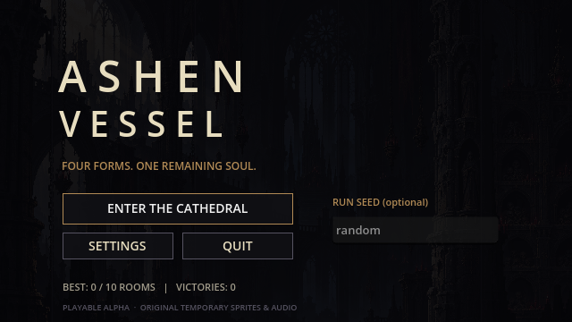
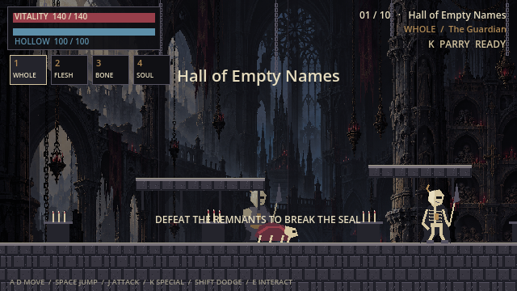
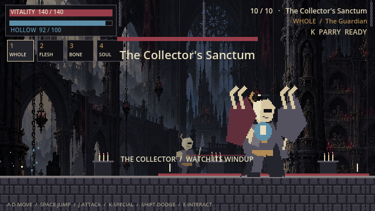
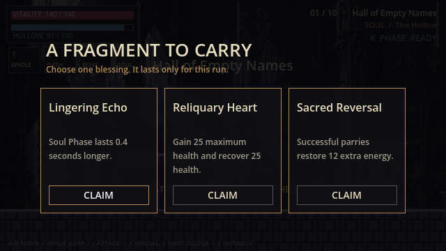

# ASHEN VESSEL

A playable alpha of an original **2D dark gothic action roguelike**, built with Godot 4 and GDScript. Explore the Cathedral of Remains as an ancient vessel that can shift between four forms: **Whole, Flesh, Bone, and Soul**.

Each form has a distinct combat role and special ability. Health and Hollow Energy are shared, so choosing when to transform is central to survival.



## Features

- Four playable forms with voluntary, energy-based transformations.
- Responsive movement, variable-height jumps, coyote time, jump buffering, and dodging.
- Melee combat, parrying, healing attacks, dashes, spectral attacks, and temporary phasing.
- Hollow Marks that reward attacking an enemy with a different form.
- Three enemy archetypes with telegraphed attacks.
- Seeded ten-room runs using six reusable layouts, with combat, reward, and recovery rooms.
- Eight temporary upgrades and a two-phase final boss: **The Collector**.
- Main menu, HUD, pause and settings screens, upgrade selection, victory, defeat, and restart.
- Audio feedback and persistent volume, fullscreen, camera shake, and best-run settings.

**Development status:** the gameplay loop is implemented and automatically tested. Character sprites, animations, music, and sound effects are temporary; final art production and human playtesting are still in progress.

## Screenshots

Actual in-engine captures from the current alpha. These show the temporary artwork and interface.

### The Cathedral of Remains — Whole form



### The Collector — boss encounter



### Choosing a run upgrade



## Getting Started

### Requirements

- **Godot 4.7.2**, the version used to build and test this project.
- Git to clone the repository.
- Python with Pillow only for asset tools and validation; Python is not required to play.

The project uses Godot's Compatibility renderer and `TileMapLayer`. Linux is the tested development platform. Windows export presets are included, but Windows builds have not been tested on Windows.

### Run on Linux

With `godot` available on your PATH:

```bash
git clone https://github.com/Hessam-Hosseinian/hollow-game.git
cd hollow-game
./run_game.sh
```

The launcher imports assets on the first run before starting the game.

### Run in the Godot Editor

Import `project.godot` into Godot, open the project, and press **F5**. To run only the main scene, open `scenes/main/main.tscn` and press **F6**.

Once assets have been imported, you can also launch from the project directory:

```bash
godot --path .
```

The internal resolution is **640×360**, with an initial **1280×720** window. Integer scaling preserves crisp pixels; other window sizes may show borders.

## Controls

| Input | Action |
|---|---|
| A / D or Left / Right arrows | Move |
| Space | Jump; hold for a higher jump |
| J | Basic attack |
| K | Current form's special ability |
| Shift or L | Dodge |
| 1 / 2 / 3 / 4 | Whole / Flesh / Bone / Soul |
| E | Interact with an altar, recovery point, or exit |
| Esc | Pause / resume |
| Mouse or Tab / Enter | Navigate menus and select upgrades |

## The Four Forms

| Form | Role | Special ability |
|---|---|---|
| **Whole — The Guardian** | Balanced combat and defense | **Parry:** time K with an incoming attack to negate damage, stagger the enemy, apply a mark, and recover energy. |
| **Flesh — The Devourer** | Heavy damage and sustain | **Devour:** a powerful close-range strike that heals only when it hits a valid enemy. |
| **Bone — The Dancer** | Speed and positioning | **Bone Dash:** pass through enemies and apply Hollow Marks. |
| **Soul — The Hollow** | Evasion and spectral combat | **Phase:** temporarily evade attacks while retaining collision with floors and walls. |

Attack a marked enemy with a different form to trigger bonus damage and recover Hollow Energy. Watch enemy windup bars before committing to an attack.

Defeat every enemy in a combat room to unlock the blue gate on the right, then press **E** nearby to advance. In reward and recovery rooms, press **E** at the central altar. During the boss's second phase, changing your attacking form earns bonus damage.

Enter a numeric seed in the main menu to replay a room sequence. For development, start a seeded run directly:

```bash
./run_game.sh -- --autostart --seed=42
```

## Validation

The development scripts use `/usr/bin/python` and require Pillow for asset checks.

```bash
/usr/bin/python tools/check_project.py
/usr/bin/python tools/check_project.py --render --live
```

The second command also exercises live enemy AI and captures screenshots. Rendering requires a graphical display. Tests use separate save files to avoid changing player settings.

The recorded validation includes **1,257 gameplay checks** against both the source project and exported PCK, plus asset validation, live AI checks, and graphical captures. See the [QA report](docs/QA_REPORT.md) and [test logs](docs/qa_logs/) for results and limitations.

## Building

Build a Godot PCK and validate it, including the full integration suite:

```bash
/usr/bin/python tools/build_pack.py --deep
```

Run the resulting package with Godot:

```bash
godot --main-pack builds/ashen-vessel.pck
```

A PCK requires the Godot runtime; it is not a standalone executable. The `builds/` directory is ignored by Git, so generated packages are not included in a repository clone.

For standalone Linux or Windows builds, install the matching **Godot 4.7.2 export templates** and use the supplied export presets. Standalone desktop exports remain pending.

## Current Limitations

- Combat balance, game feel, and the target 10–15 minute run duration need further human playtesting.
- Character and enemy sprites use temporary, low-frame-count animations.
- Music and sound effects are original synthesized placeholders.
- The cathedral background was generated with `image_gen`; its integrated rendition still needs a production pixel-art cleanup pass.
- Controller support, control remapping, and in-game localization are not implemented.
- Enemies move on the ground; ranged enemies can pressure players on platforms.

Audio levels, camera shake, fullscreen preferences, and best-run statistics are stored in `user://ashen_vessel.cfg`. Upgrades reset when a new run begins.

## Development and Asset Replacement

Gameplay configuration is stored in editable Godot resources:

| System | Location |
|---|---|
| Player forms | `resources/forms/` |
| Combat and transformation rules | `resources/combat_rules.tres` |
| Enemies | `resources/enemies/` |
| Upgrades | `resources/upgrades/` |
| Room layouts | `resources/rooms/` |

Current character sheets are **576×864**: six columns and nine rows of **96×96** transparent frames. Animation rows are `idle`, `run`, `jump`, `fall`, `attack`, `special`, `hurt`, `transform`, and `death`. Keep the foot position and pivot consistent. Update `ActorVisual` if frame dimensions or counts change.

The generators in `tools/` recreate temporary assets. Do not run them over finished replacement artwork.

## Documentation

- [Game design](docs/GAME_DESIGN.md)
- [Architecture](docs/ARCHITECTURE.md)
- [Art bible](docs/ART_BIBLE.md)
- [Asset manifest](docs/ASSET_MANIFEST.md)
- [Asset generation prompts](docs/ASSET_PROMPTS.md)
- [Development roadmap](docs/ROADMAP.md)
- [QA report](docs/QA_REPORT.md)

Next priorities are unassisted combat playtesting, difficulty tuning, and replacing the temporary four-form animation sheets with production artwork.
